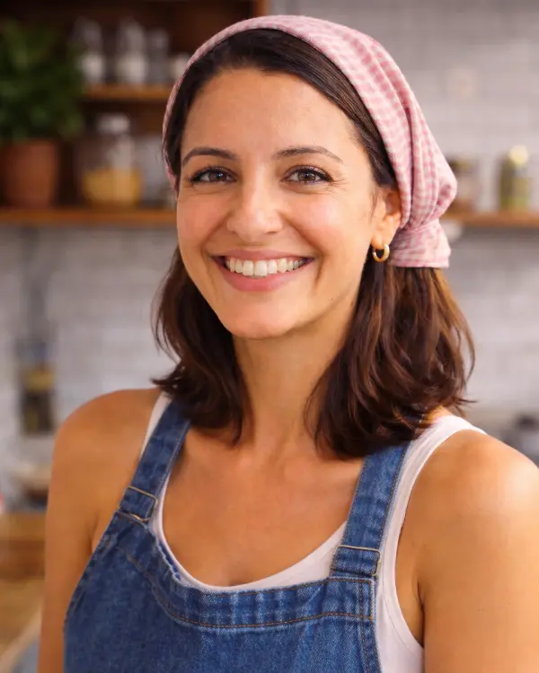

# Projeto atualizado — 100 Receitas Saudáveis

Atualização: 10/11/2026.

## O que mudou

- O HTML do primeiro bloco foi preservado, incluindo headline, subheadline, imagem, lista das 100 receitas e garantia. A alteração visual nesse bloco é a largura do botão, agora limitada a 340 px e adaptada ao celular.
- Foram adicionados quatro botões “QUERO MINHA COLEÇÃO” antes da oferta: após as imagens das receitas, a apresentação interna do material, os bônus e os depoimentos. Todos levam à oferta na própria página.
- A oferta ganhou a âncora real `#offer-box`, com espaço para a barra fixa. O destino funciona também como link HTML, sem depender do JavaScript.
- A apresentação agora destaca a composição da coleção, as informações presentes nas páginas, a utilidade dos guias e a entrega em PDF.
- Os blocos foram organizados para apresentar o produto, demonstrar o conteúdo, explicar o acesso e responder às dúvidas antes do fechamento.
- O bloco de Amanda Souza foi colocado imediatamente depois da oferta, com a área da foto em branco. Não foram acrescentadas formação, experiência, certificações ou resultados não informados.
- O fechamento antes do rodapé repete a mensagem inicial, resume o conteúdo e leva diretamente ao mesmo checkout da oferta.
- As imagens, repetições, ordem dos slides e animações originais dos três carrosséis foram preservadas. As imagens das receitas receberam largura responsiva, carregamento adiado e controles para pausar/retomar.
- Os acordeões mantêm a expansão exclusiva dentro de cada grupo e agora também funcionam por teclado, com estado acessível.

## Preço e checkout

O preço continua em **R$ 49,90**, com os valores de referência, parcelamento e custo por receita do projeto original.

O checkout da oferta e o do fechamento são:

`https://pay.hotmart.com/P105611288V?off=kds8d39y&checkoutMode=10`

Os scripts e identificadores de Meta Pixel, TikTok e UTMify foram mantidos. Não foram criados eventos de compra ou de checkout adicionais. A decoração dos dois links pela UTMify foi observada no navegador; isso não equivale a uma auditoria do recebimento de eventos nas plataformas.

Ao mudar para **R$ 67,90**, revise em conjunto:

1. O preço à vista no `index.html` (comentário `PREÇO`).
2. O parcelamento anunciado: copie a condição real exibida no checkout.
3. O texto “menos de R$ 0,50 por receita”. Com 100 receitas a R$ 67,90, o valor é R$ 0,679 por receita; a frase pode passar a “menos de R$ 0,68 por receita”.
4. O preço da oferta correspondente na Hotmart e, se necessário, seu link. Há dois links diretos no HTML.

Não há preço repetido no bloco final, para facilitar essa alteração futura.

## Como colocar a foto da Amanda

1. Salve a foto em `assets/amanda-souza.webp`.
2. No `index.html`, procure `FOTO DA AMANDA`.
3. Substitua somente esta linha:

```html
<div class="author-photo author-photo--empty" aria-hidden="true"></div>
```

por:

```html

```

Use preferencialmente uma foto vertical de proporção 4:5. O layout já está pronto para ela e não mostra imagem quebrada enquanto estiver vazia.

## Publicação

O site continua sendo HTML, CSS e JavaScript estáticos. Não há etapa de build necessária para exibir a página.

Extraia o ZIP e publique o conteúdo da pasta do projeto na raiz do site, incluindo:

- `index.html`
- `styles.css` e `conversion.css`
- `main.js` e `conversion.js`
- A pasta `assets/` inteira
- `vercel.json`, se estiver usando Vercel

O ZIP também mantém os arquivos auxiliares do projeto original. Os scripts antigos de edição não precisam ser executados para publicar esta versão; executá-los pode alterar novamente os arquivos da página. Dependências instaladas, caches e histórico local de versionamento não são necessários para servir o site e não integram o pacote.

## Conferências realizadas

- Comparação do primeiro bloco com o original: HTML preservado.
- Comparação de todas as imagens da pasta `assets`: arquivos preservados.
- Conferência da sequência dos três carrosséis: 16, 24 e 32 slides, com as mesmas repetições do original.
- Conferência de IDs únicos, âncoras, caminhos de arquivos locais e destinos de checkout.
- Verificação da sintaxe dos scripts JavaScript.
- Inspeção visual em desktop e em larguras de 320, 375, 390, 768 e 1280 px, sem transbordamento horizontal nos textos e controles principais.
- Testes de rolagem até a oferta, expansão dos acordeões por mouse/teclado e pausa/retomada dos três carrosséis.
- Conferência do contador e da data dos bônus em execução.

Não foi feita uma compra de teste nem uma publicação em produção. A eficácia comercial precisa ser medida com tráfego e vendas reais.

## Pontos encontrados no material original para revisar

- Algumas prévias de páginas, como `assets/100RECEITAS-08.webp`, contêm o crédito “Escrito por: Guilherme de C. Cintra”. Confira a atribuição correta e alinhe o produto e suas prévias com a apresentação de Amanda Souza. As imagens originais não foram retocadas.
- Essa mesma prévia contém uma observação sobre glúten e a necessidade de escolher a farinha adequada. Por isso, os blocos revisados não prometem adequação universal a restrições alimentares, e o FAQ orienta a consulta dos ingredientes de cada preparo. A headline e a subheadline originais foram preservadas conforme solicitado.
- Os links “Termos de Uso” e “Política de Privacidade” do rodapé já apontavam para `#`. Eles foram preservados; ainda precisam receber os endereços dos seus documentos reais.
- O contador continua seguindo a regra original de terminar ao fim de cada dia. A data dos bônus também continua sendo a data atual. Mantenha essas mensagens alinhadas às condições efetivamente praticadas na oferta.
